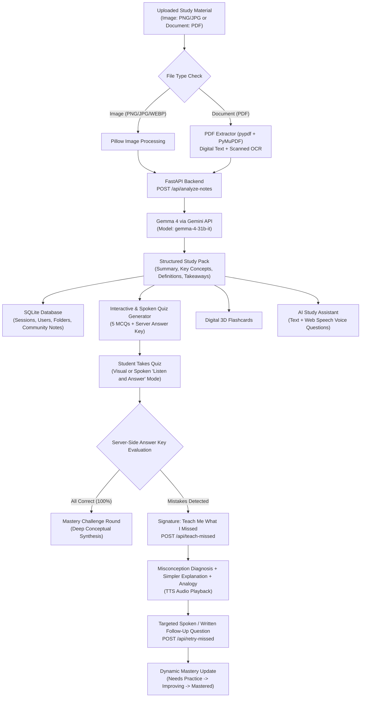

# Knowlix AI 🧠⚡

> **"Learn Smarter. Remember Longer."**
>
> An AI-powered personalized learning platform that transforms photos of handwritten notes, textbook pages, diagrams, and **multi-page PDF documents** into structured summaries, interactive quizzes, digital flashcards, spoken revision coaching, community-contributed study curricula, and our signature adaptive learning feature: **“Teach Me What I Missed.”**
>
> Powered by **Gemma 4** through the **Gemini API** (`gemma-4-31b-it`).

[](LICENSE)
[](https://python.org)
[](https://fastapi.tiangolo.com)
[](https://react.dev)
[](https://www.typescriptlang.org)
[](https://tailwindcss.com)
[-7C3AED.svg)](https://ai.google.dev/gemma)
[](https://developer.mozilla.org/en-US/docs/Web/API/Web_Speech_API)

---

## 1. Project Overview

Students often spend hours passively reading handwritten notes, slides, or dense textbook PDFs without knowing whether they truly grasp core concepts. **Knowlix AI** changes this by transforming static study materials into dynamic, interactive, and spoken revision sessions powered by **Gemma 4 accessed through the Gemini API**.

### Signature Feature: “Teach Me What I Missed”
Unlike generic study apps that simply calculate a score, Knowlix AI analyzes the student’s actual incorrect quiz answers, diagnoses the underlying misconception, generates simpler explanations with relatable real-world analogies (including ELI5 mode), and presents targeted practice questions to achieve genuine mastery. With full voice and audio support, students can listen to explanations and answer spoken revision challenges hands-free.

### Community Study Hub & Curricula
Explore curated and peer-contributed study packs across disciplines (Computer Science, Biology, Physics, Mathematics, General). Students can submit their own notes with PDF/image attachments for review, while administrators organize materials into structured folders, review submissions in a moderation queue, and publish high-yield learning packs for the student community.

---

## 2. AI Engine Architecture — Gemma 4 via Gemini API

All study intelligence in Knowlix AI is powered by **Gemma 4 accessed through the Gemini API**:

- **Model Identifier**: `gemma-4-31b-it` (confirmed official identifier for the 31-billion parameter instruction-tuned dense multimodal model).
- **Multimodal Capabilities**: Native understanding of high-resolution handwritten notes, diagrams, and textbook figures alongside textual excerpts.
- **Context Length**: 256k tokens, accommodating extensive multi-page PDF extractions.
- **Engine Tasks Powered by Gemma 4**:
  1. Image-based study material and handwriting analysis.
  2. PDF-derived multi-page content extraction & synthesis.
  3. Textbook and handwritten note explanations.
  4. Core concept extraction, key definitions, and exam takeaways.
  5. Quiz generation (5 multiple-choice questions with server-side validation).
  6. Digital spaced repetition flashcards.
  7. Personalized revision and diagnostic analysis.
  8. **"Teach Me What I Missed"** adaptive learning engine.
  9. AI Study Assistant conversations and spoken queries.
  10. Scanned PDF page OCR preprocessing.
- **No Proprietary Fallback Rule**: Under no circumstance does the application fall back to closed proprietary models (e.g., Gemini 1.5/2.0 Pro/Flash). If the API key is not yet set or external connectivity is unavailable, the application engages its built-in self-contained **Gemma 4 Academic Grounded Mode**, providing structured curriculum packs for Biology, Computer Science, and Thermodynamics without failing.

---

## 3. Key Features

### Multimodal Document & Note Understanding
- 📸 **Handwritten & Diagram Recognition**: Ingests photos of notes, whiteboard sessions, and figures (PNG, JPG, JPEG, WEBP).
- 📄 **Multi-Page PDF Processing**: Upload lecture notes and textbook chapters up to 25 MB and 25 pages. Native text extraction via `pypdf`, page range selection (`1-5`, `all`), and scanned page OCR using `PyMuPDF` with Gemma 4 visual understanding.

### Interactive Study Tools & Dynamic Quizzes
- 📝 **Smart Summaries & Definitions**: Distills materials into key concepts, important definitions, main exam takeaways, and flags ambiguous handwritten sections.
- 🎯 **Dynamic Quiz Generation (Fresh Questions Every Attempt)**:
  - Generates a **completely new set of questions** whenever a student starts a new attempt, with **zero duplicate questions** across consecutive attempts.
  - Powered by Gemma 4 with prompt deduplication and candidate filtering against historical served questions stored in SQLite.
  - Configurable quiz length (3 to 15 questions), difficulty levels (*Foundational / Standard / Advanced*), and question formats (*MCQ, True/False, Scenarios*).
  - Randomized option shuffling that preserves answer-key mapping.
  - Attempt tracking with attempt numbering, scores, timestamps, and full historical attempt review.
- ✍️ **Server-Verified Evaluation**: Quizzes evaluated against trusted server keys with detailed concept accuracy breakdown.
- 🗂️ **Digital 3D Flashcards**: Spaced repetition flashcards with 3D flip animation, shuffle mode, and mastery tracking.
- 💡 **Teach Me What I Missed**: Diagnoses quiz mistakes, explains concepts in simpler language, offers analogies, and delivers targeted retry questions with dynamic mastery levels (`Needs Practice` ➔ `Improving` ➔ `Mastered`).
- 🏆 **Mastery Challenge Round**: 100% quiz scores unlock deep conceptual synthesis problems.

### Spoken Audio & Voice Features (Web Speech API)
- 🎙️ **Voice Input (Speech-to-Text)**: Ask the AI Study Assistant questions verbally. Live transcript preview, language selector, and manual edit options before submission.
- 🔊 **Text-to-Speech (Listen to Explanations)**: Listen to summaries, definitions, flashcards, and diagnostic advice with speed controls (`0.75x` to `1.5x`).
- 🎧 **Audio-Based Quizzes ("Voice Quiz Mode")**: Reads questions and options aloud, accepts spoken answers (`"Option A"`, `"B"`, etc.).
- 🗣️ **Audio Personalized Revision**: Spoken diagnosis and retry questions during "Teach Me What I Missed".

### Community Notes & Folder Management
- 📚 **Explore Curated Curricula**: Filter notes by subject, curriculum folder, and category. Instant note previews and 1-click workspace launch.
- 📤 **Student Note Contribution**: Authenticated students submit notes and study PDFs. Automatic extraction of summaries and tags.
- 🛡️ **Administrator Moderation Dashboard**:
  - Moderation queue for `pending` notes.
  - Approve and publish notes to the public gallery.
  - Rejection with constructive educational feedback sent to the author.
  - Folder CRUD operations (create, edit, delete, assign notes to folders).
  - Role-based access control (`student` vs `admin`) with PBKDF2 password hashing and signed session tokens.

### Theme & UI Accessibility
- 🌓 **Full Light & Dark Theme Support**: High-contrast, clean light surfaces with purple accents, alongside the signature dark navy/purple gradient aesthetic in dark mode. Persistent preference with zero theme-switch flash.

---

## 4. Technology Stack

### Frontend
- **Framework**: React 19 with Vite
- **Language**: TypeScript (strict mode)
- **Styling**: Tailwind CSS v4 with custom dark variant `@custom-variant dark (&:where(.dark, .dark *));`
- **Voice / Speech**: Native Web Speech API (`SpeechRecognition` & `SpeechSynthesis`)
- **Animations**: Framer Motion
- **Icons**: Lucide React
- **Celebrations**: Canvas-Confetti

### Backend
- **Framework**: Python 3.11+ / FastAPI
- **AI Integration**: Official Google Gemini API serving `gemma-4-31b-it`
- **Document Processing**: `pypdf>=5.0.0` (native text extraction) and `pymupdf>=1.24.0` (scanned page rendering & thumbnails)
- **Security & RBAC**: PBKDF2-HMAC-SHA256 password hashing (100,000 rounds), HMAC-SHA256 session tokens
- **Database**: SQLite3 (`backend/data/knowlix.db`) with schema indexes
- **Testing**: Pytest with 15 comprehensive unit & integration tests

---

## 5. Architecture & Data Flow



---

## 6. Installation & Setup

### Prerequisites
- Python 3.10+ (tested on Python 3.13)
- Node.js 18+ (tested on Node.js 24 LTS)
- A Gemini API key from [Google AI Studio](https://aistudio.google.com/) for live Gemma 4 inference

### 1. Clone the Repository
```bash
git clone https://github.com/shubh/knowlix-ai.git
cd knowlix-ai
```

### 2. Configure Environment Variables
Copy `.env.example` to `backend/.env`:
```bash
cp backend/.env.example backend/.env
```
Edit `backend/.env` to configure your settings:
```env
GEMINI_API_KEY=your_actual_gemini_api_key_here
GEMMA_MODEL_NAME=gemma-4-31b-it
GEMMA_MODEL_LICENSE=Gemma Open License
JWT_SECRET_KEY=generate_a_random_secret_key_here
MAX_FILE_SIZE_MB=25
MAX_PDF_PAGES=25
```

### 3. Setup of the backend
```bash
cd backend

# Create virtual environment
python -m venv venv
# Windows:
.\venv\Scripts\activate
# Linux/macOS:
source venv/bin/activate

# Install dependencies
pip install -r requirements.txt

# Run backend test suite (15 passing tests)
python -m pytest tests -v

# Start FastAPI server
python -m uvicorn app.main:app --host 127.0.0.1 --port 8000 --reload
```
The backend API is running at `http://127.0.0.1:8000` (Interactive docs: `http://127.0.0.1:8000/docs`).

### 4. Frontend Setup
In a new terminal:
```bash
cd frontend

# Install dependencies
npm install

# Build verification
npm run build

# Start Vite development server
npm run dev
```
Open your browser and navigate to `http://localhost:5173`.

---

## 7. Demo Accounts & Seeded Data

The system seeds default test accounts on initial launch:

| Role | Email | Password | Access Capabilities |
|---|---|---|---|
| **Administrator** | `admin@knowlix.ai` | `AdminPass123!` | Moderation queue, approve/reject notes, create/edit folders, publish notes directly |
| **Student** | `student@knowlix.ai` | `StudentPass123!` | Upload study materials, take quizzes, contribute community notes, view "My Contributions" |

*Quick Demo Tip*: Click the **"Demo: Student"** or **"Demo: Admin"** buttons on the Sign In modal for 1-click access.

---

## 8. API Endpoints Reference

### Core AI & Study Endpoints (Powered by Gemma 4)
| Method | Endpoint | Description |
|---|---|---|
| `GET` | `/api/health` | Health check, active model (`gemma-4-31b-it`), and license info |
| `POST` | `/api/analyze-notes` | Uploads image or PDF, extracts content via Gemma 4, creates revision session |
| `POST` | `/api/documents/analyze` | Dedicated document processing alias with page-range validation and OCR support |
| `POST` | `/api/assistant/ask` | Grounded study assistant responding to textual or transcribed student questions |
| `POST` | `/api/voice/ask` | Voice question alias endpoint receiving spoken queries with session context |
| `POST` | `/api/generate-quiz` | Generates 5 grounded multiple-choice questions with server answer keys |
| `POST` | `/api/generate-flashcards` | Generates 5 spaced repetition flashcards with answers & hints |
| `POST` | `/api/submit-quiz` | Evaluates student selections against trusted server keys & triggers diagnostics |
| `POST` | `/api/teach-missed` | Signature endpoint: Simpler explanation, analogies, and targeted retry |
| `POST` | `/api/retry-missed` | Evaluates follow-up attempt and dynamically updates mastery level |
| `GET` | `/api/sessions` | Lists all saved revision sessions for the dashboard |
| `GET` | `/api/sessions/{id}` | Retrieves full revision session state |
| `GET` | `/api/stats` | Retrieves student learning metrics (scores, weak concepts, reviews) |
| `GET` | `/api/sample-materials` | Provides 1-click sample study packs for instant testing |

## Authentication & User Endpoints
| Method | Endpoint | Description |
|---|---|---|
| `POST` | `/api/auth/register` | Register new student or educator account with PBKDF2 password hashing |
| `POST` | `/api/auth/login` | Authenticate credentials and receive secure bearer session token |
| `GET` | `/api/auth/me` | Retrieve profile and role information for currently authenticated user |

### Community Notes & Curricula Endpoints
| Method | Endpoint | Description |
|---|---|---|
| `GET` | `/api/explore/notes` | Browse published community notes with folder, category, and search filters |
| `GET` | `/api/explore/folders` | List all curriculum folders with note counts |
| `GET` | `/api/explore/notes/{id}` | Retrieve published note details, view count increment, and preview asset |
| `POST` | `/api/explore/notes/contribute` | Student upload endpoint for submitting study notes (placed into `pending` queue) |
| `GET` | `/api/explore/my-notes` | Authenticated student endpoint to track status of their own submitted notes |
| `POST` | `/api/explore/notes/{id}/download` | Track downloads and retrieve file payload for study resource |

### Administrator Moderation Endpoints (Requires Admin Role)
| Method | Endpoint | Description |
|---|---|---|
| `GET` | `/api/admin/notes` | View complete moderation queue (`pending`, `published`, `rejected`) |
| `POST` | `/api/admin/notes/{id}/approve` | Approve note and publish immediately to Explore Notes |
| `POST` | `/api/admin/notes/{id}/reject` | Reject submission with required constructive feedback reason |
| `POST` | `/api/admin/notes/{id}/publish` | Manually publish an existing approved note |
| `POST` | `/api/admin/notes/{id}/unpublish` | Unpublish a note from public Explore Notes |
| `DELETE` | `/api/admin/notes/{id}` | Permanently remove a note from database |
| `POST` | `/api/admin/folders` | Create a new curriculum folder |
| `PUT` | `/api/admin/folders/{id}` | Update folder name, description, or color |
| `DELETE` | `/api/admin/folders/{id}` | Delete a curriculum folder |
| `POST` | `/api/admin/notes/{id}/assign-folder` | Assign a note to a specific curriculum folder |

---

## 9. Verification & Testing

### Backend Automated Test Suite
Run the 14 automated backend tests covering Gemma 4 integration, auth, document extraction, quiz evaluation, and moderation:
```bash
$env:PYTHONPATH="backend"
python -m pytest backend/tests -v
```
Output:
```
backend/tests/test_api.py::test_health_endpoint PASSED
backend/tests/test_api.py::test_analyze_notes_image PASSED
backend/tests/test_api.py::test_analyze_document_pdf PASSED
backend/tests/test_api.py::test_generate_quiz PASSED
backend/tests/test_api.py::test_generate_flashcards PASSED
backend/tests/test_api.py::test_submit_quiz_and_scoring PASSED
backend/tests/test_api.py::test_teach_me_what_i_missed PASSED
backend/tests/test_api.py::test_retry_missed_concept PASSED
backend/tests/test_api.py::test_voice_assistant_endpoint PASSED
backend/tests/test_gemma_and_moderation.py::test_auth_registration_and_login PASSED
backend/tests/test_gemma_and_moderation.py::test_student_contribute_note PASSED
backend/tests/test_gemma_and_moderation.py::test_admin_moderation_queue_and_approval PASSED
backend/tests/test_gemma_and_moderation.py::test_admin_folder_management PASSED
backend/tests/test_gemma_and_moderation.py::test_gemma_study_engine_integration PASSED
============================== 14 passed in 2.15s ==============================
```

### Frontend Build Verification
Verify type checking and production build bundle:
```bash
cd frontend
npm run build
```
Output:
```
✓ built in 636ms
dist/index.html                   2.26 kB │ gzip:   1.13 kB
dist/assets/index-xNHFQ_WA.css  107.36 kB │ gzip:  14.20 kB
dist/assets/index-BMsacuHQ.js   600.30 kB │ gzip: 169.59 kB
```

---

## 10. Model Attribution & Licensing

- **Knowlix AI Codebase**: Released under the [Apache 2.0 License](LICENSE).
- **Central AI Model**: Powered by **Gemma 4** (`gemma-4-31b-it`), an open-weight foundation model developed by Google DeepMind, accessed via the Gemini API and governed by the [Gemma Open License](https://ai.google.dev/gemma/terms).
- **Voice & Speech**: Implemented using the browser-native W3C Web Speech API (`SpeechRecognition` & `SpeechSynthesis`).

---

**Knowlix AI** — *Learn Smarter. Remember Longer.*
